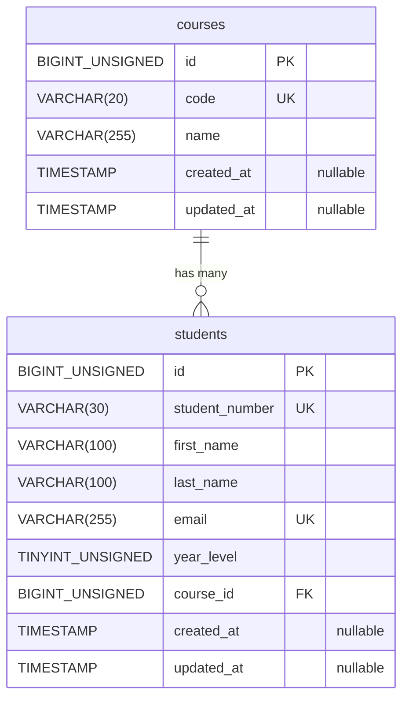
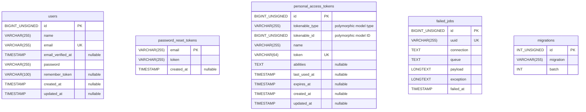

# Entity Relationship Diagram: student_records_demo

This diagram reflects the tables, columns, keys, and foreign key inspected in the running database on October 28, 2026. The database uses XAMPP MariaDB through Laravel's MySQL connection.

## Student Records CRUD relationship

- **One course → zero or many students.** A new course can exist before students are assigned to it.
- **Each student → exactly one course.** `students.course_id` is required and references `courses.id`.
- **PK** means primary key: it identifies a row. **FK** means foreign key: it references another table. **UK** means a unique key: duplicate values are rejected.
- Student number and email must each be unique across students; course code must be unique across courses.
- Deleting a course with assigned students is restricted. Deleting a student leaves the course intact.
- All columns are required unless marked nullable. Eloquent maintains the created/updated timestamps.
- The application validates year level as 1–4; the database column itself is an unsigned tiny integer, without a 1–4 check constraint.

### How the relationship appears in Laravel

| Database relationship | Eloquent definition | Example access |
| --- | --- | --- |
| `courses.id` is referenced by many student rows | `Course::students()` returns `hasMany(Student::class)` | `$course->students` |
| `students.course_id` references one course row | `Student::course()` returns `belongsTo(Course::class)` | `$student->course->name` |

**Presenter explanation:** “The courses table stores each course once. A student stores the course's ID in course_id. This connects many students to one course without repeating the full course details in every student record.”

## Other tables present in the database

Laravel's skeleton also created the following five tables. They have **no declared database foreign keys** linking them to the student/course tables or to each other in the inspected schema.

| Table | Purpose in the Laravel skeleton |
| --- | --- |
| `users` | User account storage; the student CRUD does not implement login. |
| `password_reset_tokens` | Password-reset tokens keyed by email; email is not a declared foreign key to users. |
| `personal_access_tokens` | Sanctum token storage. The tokenable type/ID pair supports an application-level polymorphic relationship, not a declared foreign key. It is unused by this CRUD demo. |
| `failed_jobs` | Failed queued-job records; unrelated to students and courses. |
| `migrations` | Tracks applied migrations and their batch numbers. It is schema history, not student data. |

The two diagrams together cover all seven tables currently in the database. For the classroom CRUD explanation, use the first diagram. View this file in a Markdown renderer with Mermaid support to display the diagrams.
