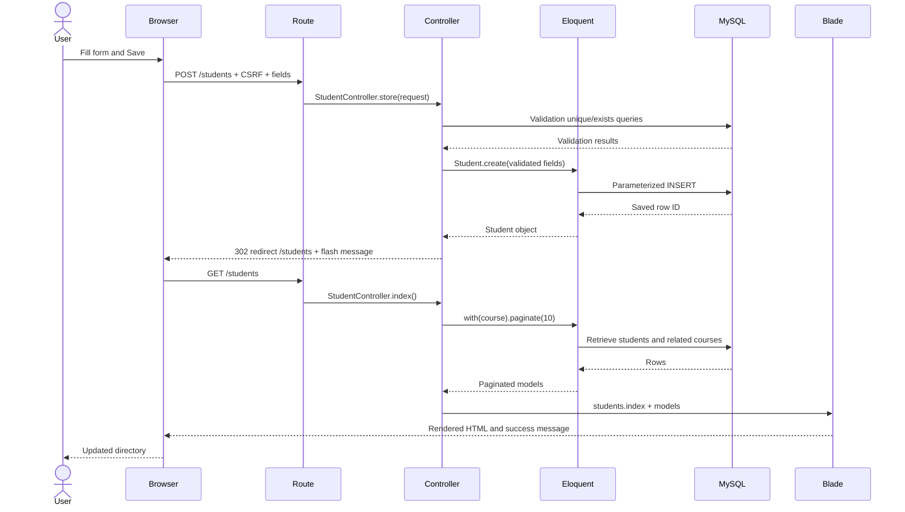

# Follow a request through Laravel

This is the main teaching reference. **MVC** separates responsibilities: the Model represents data and relationships, the View presents HTML, and the Controller coordinates the request. The route decides which controller action handles an address and HTTP method. MySQL stores the records; it is separate from the model class.

**User → Browser/Form → Route → Controller → Eloquent Model → MySQL → Controller → Blade View → Browser**

For writes, there is an extra redirect/new GET before Blade renders. The write action does not directly return the list HTML.

## Create: open the form, then save

1. User clicks **Add student**. Browser sends GET /students/create.
2. Route students.create calls StudentController::create().
3. Controller uses Course::orderBy('code')->get(); Eloquent queries the database for dropdown choices.
4. Controller passes courses to students/create.blade.php, which includes _form.blade.php; Blade renders HTML.
5. User fills fields and clicks **Save student**. The browser sends POST /students with fields and a hidden CSRF token.
6. Web middleware checks CSRF. Route students.store invokes store(Request $request).
7. validatedData() checks required fields, format, lengths, year range, duplicate numbers/emails, and course existence. The uniqueness/existence checks query the database too.
8. Student::create($validatedData) turns validated values into a parameterized INSERT. MySQL persists the row; Eloquent returns a model with its ID.
9. Controller flashes success and returns a 302 redirect to students.index. Browser makes a **new GET** /students.
10. index() queries students/courses, passes models to Blade, and the browser displays the refreshed list and message.

**Failure branch:** validation redirects back without inserting anything. Laravel flashes errors and old input; Blade shows both. CSRF failure returns 419 before the action saves anything.

**Presenter:** “The form sends information; the route chooses store; validation checks it; the model saves it. Then we request the list again.”

## Read: directory and individual details

1. User opens /students; browser sends GET.
2. Route students.index invokes index().
3. Student::with('course')->orderBy(...)->paginate(10) asks Eloquent for a page, count, and related courses. MySQL returns data; Eloquent creates objects.
4. Controller passes $students to students/index.blade.php.
5. Blade loops over models and accesses $student->course->code. Browser receives HTML, not PHP or SQL.
6. Clicking **View** sends GET /students/ID to students.show. Route model binding retrieves the student or returns 404.
7. show(Student $student) loads its course and passes the model to students/show.blade.php. The browser shows the details.

Pagination is another GET with ?page=2. No records are changed during read operations.

**Presenter:** “The model fetches data, the controller hands it to the view, and Blade turns it into the table you see.”

## Update: load existing values, then change a row

1. User clicks **Edit**. GET /students/ID/edit matches students.edit.
2. Binding retrieves the existing student; edit() also loads course choices. Controller passes both to students/edit.blade.php.
3. Blade fills the shared form with existing values. old() takes priority after a failed submission.
4. User changes fields and clicks **Save changes**. HTML sends POST with CSRF and hidden _method=PUT.
5. Laravel treats it as PUT /students/ID; students.update invokes update(Request $request, Student $student).
6. Controller validates. Unique rules ignore this bound record so unchanged number/email are allowed, but duplicates belonging to other students are rejected.
7. $student->update($validatedData) makes Eloquent issue UPDATE for this primary key. MySQL persists the changes and Eloquent updates timestamps.
8. Controller flashes success and redirects to students.show. Browser makes GET /students/ID, reloads data, and receives details HTML from Blade.

**Failure branch:** errors return to the edit form with submitted values; the saved row stays unchanged.

**Presenter:** “The ID chooses which row to update. Validation still applies, and the course dropdown stores an ID while displaying a name.”

## Delete: confirm and remove one row

1. User clicks **Delete** in the table or details screen. Browser confirm() asks for confirmation.
2. **Cancel** returns false and no request is sent. **OK** submits POST with CSRF and _method=DELETE.
3. Laravel reads DELETE /students/ID, matches students.destroy, validates CSRF, and binds the existing model.
4. destroy(Student $student) calls $student->delete(). Eloquent issues DELETE using its primary key.
5. MySQL removes the student row; its course remains. There is no soft-delete feature here.
6. Controller flashes success and redirects to /students. Browser makes GET; index() queries the remaining students; Blade renders the updated directory.
7. Refreshing the list confirms deletion persists. The former student's URL now returns 404.

The JavaScript prompt is a usability safeguard, not authentication or server authorization. This local example has no login system.

**Presenter:** “Confirmation happens in the browser. Deletion happens only after the controller tells the model to remove the record.”

## One-minute recap

Route: **Where does this request go?** Controller: **What should happen?** Model/Eloquent: **How do we work with related data?** MySQL: **Where is data stored?** Blade: **What HTML should the user see?** Validation rejects invalid input before saving; CSRF checks the form's session token. Create/update/delete end with a redirect and a fresh read of the saved data.

Official references used for the implementation: [Laravel 10 migrations](https://laravel.com/framework/docs/10.x/migrations) and [Laravel 10 unique validation rule API](https://api.laravel.com/docs/10.x/Illuminate/Validation/Rules/Unique.html).
